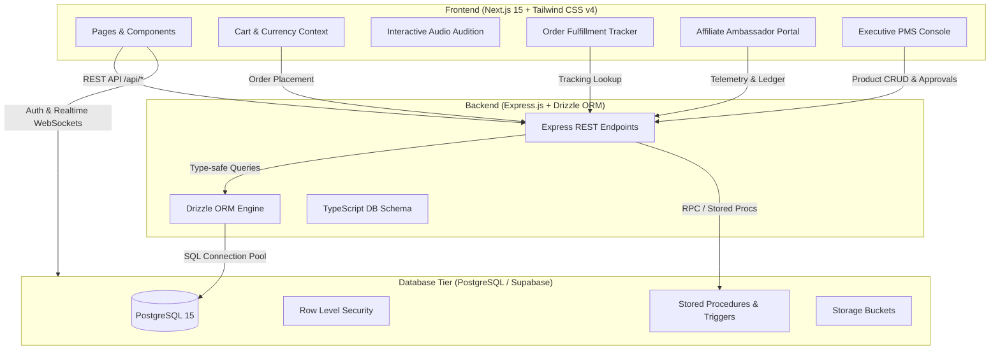

# Amiele Begena (ዓሚኤል በገና)

[](https://nextjs.org/)
[](https://expressjs.com/)
[](https://orm.drizzle.team/)
[](https://supabase.com)
[](#)

> **Preserving sacred acoustic heritage and ancient Ethiopian craftsmanship through a curated digital storefront, high-fidelity audio audition, multi-currency commerce, and secure referral tracking.**

Amiele Begena (ዓሚኤል በገና) is a full-stack cultural e-commerce platform dedicated to traditional, handcrafted Ethiopian musical instruments (Begena, Kirar, Masinko, Kebero, Washint). The project has been fully upgraded to a decoupled, high-performance architecture:
- **Frontend (`frontend/`):** **Next.js 15 (App Router)** with **Tailwind CSS v4** and **TypeScript**.
- **Backend (`backend/`):** **Express.js** with **Drizzle ORM**, **PostgreSQL (Supabase)**, and **TypeScript**.

---

## 🏗️ Architecture Overview



---

## 📁 Repository Structure

```
amiele project/
├── frontend/                     # Next.js 15 + Tailwind CSS v4 (TypeScript)
│   ├── public/
│   │   ├── image/                # High-resolution instrument images
│   │   ├── audio/                # Acoustic audio previews (Begena, Kirar, Masinko)
│   │   └── fonts/                # Custom Benaiah typeface
│   ├── src/
│   │   ├── app/
│   │   │   ├── layout.tsx        # Root layout with providers & fonts
│   │   │   ├── page.tsx          # Homepage with Hero, Showcase & Testimonials
│   │   │   ├── products/         # Instrument catalog (Filters, Search, Sorting)
│   │   │   ├── track-order/      # Real-time multi-stage fulfillment tracker
│   │   │   ├── affiliate/        # 8% partner program landing & application
│   │   │   │   ├── apply/        # Ambassador intake form
│   │   │   │   └── dashboard/    # Live metrics, referral link & withdrawals
│   │   │   ├── admin/            # Executive analytics, PMS, and order payouts
│   │   │   ├── blog/             # Cultural organology & acoustic articles
│   │   │   ├── about/            # Sacred heritage & artisan lineage
│   │   │   ├── sustainability/   # Highland wood ethics & fair artisan trade
│   │   │   ├── shipping/         # Worldwide export delivery from Addis Ababa
│   │   │   ├── contact/          # Workshop inquiries & direct WhatsApp link
│   │   │   ├── login/            # Authentication portal (Supabase)
│   │   │   ├── account/          # Customer profile & saved history
│   │   │   └── globals.css       # Tailwind CSS v4 + Ethiopian gold theme
│   │   ├── components/           # Navbar, Footer, CartDrawer, WhatsAppModal, etc.
│   │   ├── context/              # CurrencyContext, CartContext, AuthContext
│   │   ├── lib/                  # Backend API client, Supabase client, types
│   │   └── data/                 # Hydration catalog & cultural blog posts
│   ├── .env.example
│   ├── package.json
│   └── README.md
│
├── backend/                      # Express.js + Drizzle ORM + PostgreSQL (TypeScript)
│   ├── src/
│   │   ├── db/
│   │   │   ├── schema.ts         # Full Drizzle schema for all tables & relations
│   │   │   └── index.ts          # Drizzle ORM database instance
│   │   ├── controllers/          # Products, Orders, Affiliates, Admin controllers
│   │   ├── routes/               # Express router modules
│   │   ├── utils/                # Supabase client adapter & RPC helper
│   │   └── index.ts              # Express application server entrypoint
│   ├── drizzle.config.ts
│   ├── .env.example
│   ├── package.json
│   └── README.md
│
├── supabase/                     # Database migrations, triggers, and RLS policies
├── package.json                  # Root monorepo script runner
└── README.md                     # Main documentation
```

---

## ⚡ Quick Start (Local Development)

### 1. Install Dependencies for Both
From the root directory:
```bash
npm run install:all
```
*(Or navigate to `frontend` and `backend` separately and run `npm install` in each).*

### 2. Configure Environment Variables
- **Backend:**
  ```bash
  cd backend
  cp .env.example .env
  ```
  Ensure `PORT=5000` and your Supabase / PostgreSQL credentials are set.

- **Frontend:**
  ```bash
  cd frontend
  cp .env.example .env.local
  ```
  Ensure `NEXT_PUBLIC_API_URL=http://localhost:5000/api`.

### 3. Run Development Servers
You can run both concurrently from the root:
```bash
npm run dev
```
Or run each service in its own terminal window:
- **Run Backend:** `npm run dev:backend` (accessible at `http://localhost:5000`)
- **Run Frontend:** `npm run dev:frontend` (accessible at `http://localhost:3000`)

---

## 🚢 Independent Deployment Guide

Because the frontend and backend are completely decoupled into dedicated folders, you can deploy them on different cloud platforms:

### 🌐 Deploying the Frontend (e.g., Vercel / Netlify)
1. Push your repository to GitHub.
2. In [Vercel](https://vercel.com/):
   - Import your repository.
   - Set **Root Directory** to `frontend`.
   - Framework Preset: **Next.js**.
   - Add Environment Variables:
     - `NEXT_PUBLIC_API_URL` = Your live backend URL (e.g. `https://amiele-backend.onrender.com/api`)
     - `NEXT_PUBLIC_SUPABASE_URL` = Your Supabase project URL
     - `NEXT_PUBLIC_SUPABASE_ANON_KEY` = Your Supabase anon key
     - `NEXT_PUBLIC_WHATSAPP_NUMBER` = `251969189470`
3. Click **Deploy**.

### ⚙️ Deploying the Backend (e.g., Render / Railway / Fly.io / VPS)
1. In [Render](https://render.com/) or [Railway](https://railway.app/):
   - Create a new **Web Service**.
   - Set **Root Directory** to `backend`.
   - Build Command: `npm install && npm run build`
   - Start Command: `npm start`
   - Add Environment Variables:
     - `PORT` = `5000` (or assigned by platform)
     - `NODE_ENV` = `production`
     - `CORS_ORIGIN` = Your live frontend URL (e.g. `https://amielebegena.vercel.app`)
     - `SUPABASE_URL` = Your Supabase project URL
     - `SUPABASE_ANON_KEY` = Your Supabase anon key
     - `DATABASE_URL` = Your PostgreSQL connection string
2. Deploy the service and update `NEXT_PUBLIC_API_URL` on your frontend with the backend URL.

---

## 🎵 Cultural Heritage Instruments
- **በገና (Begena):** 10-stringed box lyre, tuned to ancient pentatonic modes (*Tizita*, *Bati*, *Ambassel*, *Anchi Hoye*).
- **ክራር (Kirar):** Traditional 6-string bowl lyre available in acoustic hardwood and modern electric variant.
- **ማሲንቆ (Masinko):** Diamond-shaped, single-stringed bowed lute with genuine horsehair bow.
- **ከበሮ (Kebero):** Double-headed ceremonial liturgical drum.
- **ዋሽንት (Washint):** End-blown mountain bamboo flute.
- **ጸናጽል (Sanasel):** Liturgical brass and copper sistrum.
- **መለከት (Meleket):** Ancient royal ceremony long trumpet.
